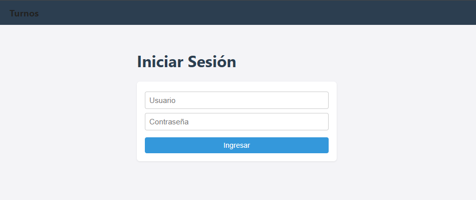
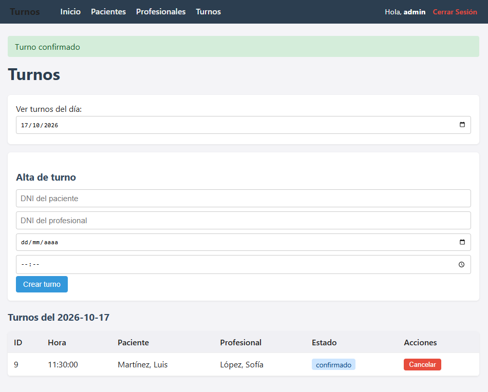
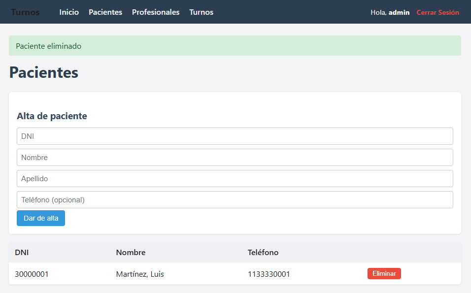

# Sistema de Gestión de Turnos

Sistema de gestión de turnos médicos desarrollado en Python, con
arquitectura en 3 capas (Presentación, Lógica y Datos) y base de datos
MariaDB en un servidor Linux.

> Mirá la **[Guía de Instalación paso a paso aquí](Guia_instalacion.md)**.

> Mirá la **[Guía de Instalación local](instalacion_local.md)**.

## Descripción

Sistema para gestionar turnos médicos entre pacientes y profesionales.
Permite dar de alta pacientes y profesionales, crear turnos, confirmarlos,
cancelarlos y consultarlos por fecha o por paciente.

El proyecto está pensado con **arquitectura en capas** para separar
responsabilidades, facilitar el mantenimiento y permitir cambiar la
interfaz (consola, web) sin tocar la lógica.

---

## Funcionalidades

### Usuarios (Login)
- Inicio de sesión con usuario y contraseña.
- Contraseñas encriptadas en la base de datos (usando SHA-256).
- Protección de rutas: sin login, no se puede acceder a la gestión de turnos.
- Cierre de sesión.
- **Usuario por defecto:** `admin` / `admin123`

### Pacientes
* Alta de paciente (DNI, nombre, apellido, teléfono).
* Listado de todos los pacientes.
* Modificación de datos por DNI.
* Baja por DNI.

### Profesionales
* Alta de profesional (DNI, nombre, apellido, especialidad).
* Listado de todos los profesionales.
* Modificación de datos por DNI.
* Baja por DNI.

### Turnos
* Alta de turno (paciente, profesional, fecha, hora).
* Confirmación de turno.
* Cancelación de turno.
* Reprogramación de turno.
* Listado de turnos por fecha.
* Listado de turnos por paciente.

---

## Reglas de negocio

Todas las reglas se validan en la capa de lógica antes de tocar la base de datos.

### Pacientes
* El DNI es obligatorio.
* No puede haber dos pacientes con el mismo DNI.

### Profesionales
* El DNI es obligatorio.
* No puede haber dos profesionales con el mismo DNI.

### Turnos
* La fecha y hora deben ser futuras.
* El paciente debe existir.
* El profesional debe existir.
* No puede haber dos turnos solapados para el mismo profesional en la misma fecha y hora (todos los turnos duran 30 minutos).
* Solo se pueden confirmar turnos pendientes.
* No se pueden cancelar turnos ya cancelados o atendidos.
* No se pueden reprogramar turnos cancelados o atendidos.
* Un turno cancelado o ausente libera el horario, permitiendo dar ese turno a otro paciente.

---

## Arquitectura

El sistema está dividido en 3 capas:

* **Capa de Presentación (presentacion/):** Se encarga de la interfaz con el usuario.
* **Capa de Lógica o Negocio (logica/):** Aplica todas las reglas del sistema, validaciones y excepciones de los turnos sin saber cómo se maneja el código SQL.
* **Capa de Datos (datos/):** Tiene acceso directo a MariaDB. Se encarga de gestionar las conexiones y procesar el código SQL.

### Reglas de comunicación entre capas

- La **presentación** solo habla con la **lógica**.
- La **lógica** solo habla con los **datos**.
- Los **datos** solo hablan con **MariaDB**.
- La presentación **nunca** accede directo a los datos.

---

## 📸 Capturas de Pantalla

### 1. Pantalla de Inicio de Sesión

### 2. Gestión de Turnos

### 3. Pacientes

